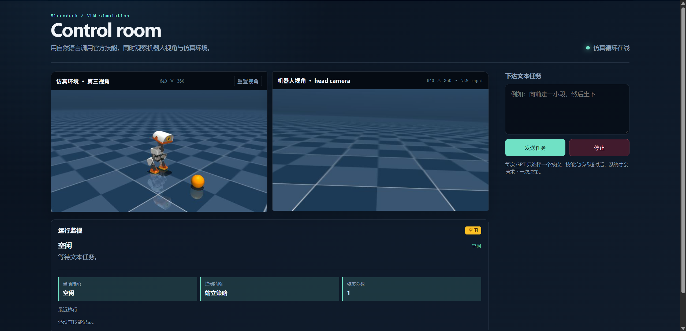

# gpt-microduck

Use GPT-6-Astra for high-level decision-making, and send motion control
commands to MicroDuck.



## VLM Web Demo

This fork adds a small browser interface that puts a GPT high-level controller
in front of Microduck's local ONNX skills. MuJoCo and the low-level policy loop
stay local at 50 Hz. GPT receives the user's task, the latest head-camera
image, and a compact execution summary, then selects one skill at a time.
The camera image is used by the VLM only; it is not part of the ONNX
observation.

The demo currently supports walking, standing, sit/stand, ground pick, ball
kicks, and roulade. The browser shows both the robot head-camera view and a
mouse-controlled third-person view.

This work also includes two runtime adjustments:

- The walking command's lateral velocity `vel_cmd[1]` (`vy`) is limited to
  `±0.3 m/s`; very small commands can fail to start the robot from rest.
- The simulated `head_camera` pose and orientation were adjusted so its view
  matches the intended robot-facing direction.

**Development status:** The VLM integration is still under active development.
Historical context handling and the `SYSTEM_PROMPT` are still being refined.

```Shell
git clone https://github.com/Lourisy/gpt-microduck.git
cd gpt-microduck
```

Before starting the demo, place the [required policy files](https://huggingface.co/pollen-robotics/microduck-policies/tree/main) at these paths:

```text
official_policies/alpha_stand.onnx
official_policies/alpha_ground_pick.onnx
official_policies/alpha_sitstand.onnx
official_policies/ball_kick_left.onnx
official_policies/ball_kick_right.onnx
official_policies/roulade.onnx
my_onnx/velocity_rough_model_49999.onnx
```

```Shell
uv run --with huggingface_hub hf download \
pollen-robotics/microduck-policies \
alpha_stand.onnx \
alpha_ground_pick.onnx \
alpha_sitstand.onnx \
ball_kick_left.onnx \
ball_kick_right.onnx \
roulade.onnx \
--revision main \
--local-dir .\official_policies
```

Referring to the [microduck_rl](https://github.com/pollen-robotics/microduck_rl) repository, I prepared the official weights at `my_onnx`. Since I found that the official policy cannot start from a standstill at low commanded velocities, I trained my own policy for the velocity-rough task with 50,000 steps.

### Run locally

Install the project environment, then start the server in headless mode:

```bash
uv sync
MUJOCO_GL=egl .venv/bin/python scripts/vlm_web.py --fake-vlm
```

Open [http://127.0.0.1:8080](http://127.0.0.1:8080). `--fake-vlm` exercises the complete simulator and
web UI without sending requests to a model provider.If you use fake-vlm, you will only get a response indicating forward movement.

For GPT control, create the ignored local file
`scripts/vlm_local_config.py`:

```python
OPENAI_API_KEY = "replace-with-a-new-key"
OPENAI_BASE_URL = "https://your-openai-compatible-endpoint/v1"
OPENAI_MODEL = "gpt-6-astra"
```

Then run:

```bash
MUJOCO_GL=egl uv run python scripts/vlm_web.py
```

The default scene is `src/mjlab_microduck/robot/microduck/scene_ball.xml`.

The API key is local configuration and must never be committed. If a key has
appeared in a chat, terminal log, screenshot, or Git history, revoke it before
publishing this repository and create a replacement.

Use a different compatible MuJoCo scene with `--scene`:

```bash
MUJOCO_GL=egl uv run python scripts/vlm_web.py \
  --scene src/mjlab_microduck/robot/microduck/scene_apartment.xml
```

The web demo is an optional entry point. The original training, play, export,
and keyboard inference commands above remain independent of it.

## Related projects

- [microduck](https://github.com/pollen-robotics/microduck) — the Microduck project home, including the onboard runtime that runs the exported policies
- [mjlab](https://github.com/mujocolab/mjlab) — the training framework (MuJoCo Warp + rsl_rl)
- [BAM](https://github.com/Rhoban/bam) — better actuator models, by Rhoban

## License

The code in this repository is licensed under the Apache License 2.0. See the [LICENSE](LICENSE) file for details.

The 3D model files (the `.stl` meshes in `src/mjlab_microduck/robot/microduck/assets/`
and `src/mjlab_microduck/robot/xl330_test_bench/assets/`) are licensed under
[Creative Commons Attribution-NonCommercial-ShareAlike 4.0 International (CC BY-NC-SA 4.0)](https://creativecommons.org/licenses/by-nc-sa/4.0/).
See [LICENSE-MODELS.md](LICENSE-MODELS.md) for the exact scope and attribution.
